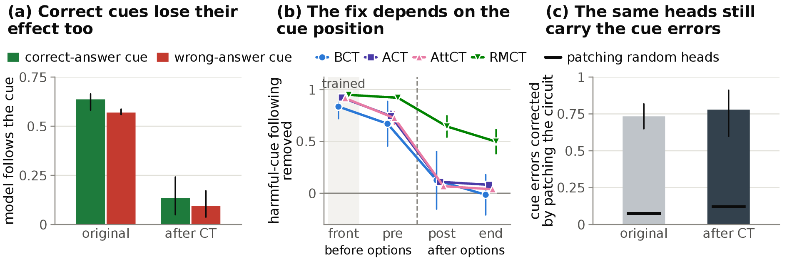

# Consistency Training Suppresses Cue Following Without Teaching Cue Selectivity

This repository contains the code for the paper of the same name.

Language models often change their answer because of a *cue*, a hint such as "I believe the answer is B" that gives no
valid evidence. Consistency training (CT) trains a model to answer the same with and without the cue. We train four CT
methods (BCT, ACT, AttCT and RMCT) on Gemma-2-2B-it and Llama-3.1-8B-Instruct with the same data. We test predictions
that we wrote down in advance, and we inspect the trained models with a known circuit that carries cues to the answer.

All four methods make the trained cue less effective, and their fixes share three properties.

1. Correct cues lose about as much influence as wrong ones.
2. The fix is usually large for cues placed before the answer options, as in training, and much smaller for cues placed
   after them.
3. The same attention heads still carry most of the remaining cue-induced errors.

CT thus weakens the trained cue without teaching models when a cue is right.

<p align="center">
  
</p>

## Installation

```bash
git clone https://github.com/prakharg55/bias_ct_eval.git
cd bias_ct_eval
pip install -r requirements.txt
pip install -e .
```

We used Python 3.12, and the code needs 3.12 or newer. Training and evaluation ran on one NVIDIA A100 GPU per job,
and the analysis runs on a CPU.

## Data, models and other code

Set these environment variables before running anything ([`src/ctcue/paths.py`](src/ctcue/paths.py) lists them too).

| Variable | Location |
|---|---|
| `CT_ROOT` | A working folder. The code writes training data to `shared/`, adapters to `models/` and results to `results/`. |
| `BCT_DUMPS` | The `dataset_dumps` folder of [Chua et al. (2024)](https://github.com/raybears/cot-transparency). |
| `HF_HOME` | A Hugging Face cache with `google/gemma-2-2b-it` and `meta-llama/Llama-3.1-8B-Instruct`. |
| `ATTCT_REPO` | A checkout of [c-wei/AttCT](https://github.com/c-wei/AttCT) at commit `b3c1896`. |
| `RMCT_SRC`, `RMCT_UPSTREAM` | A checkout of the RMCT authors' fork [sohaibimran7/cot-transparency](https://github.com/sohaibimran7/cot-transparency) at commit `4392d15`. Both can point to the same folder. |
| `RMCT_PYLIBS` | A folder with `tinker` 0.19.0 and `tinker-cookbook` 0.4.1, for example installed with `pip install --target`. |

BCT, ACT and AttCT train with the AttCT code, unchanged, and our configurations. For ACT and AttCT, our launcher
replaces only the repository's dataloader, so that they read the same prompts as BCT. RMCT trains with its authors'
trainer, unchanged. The modules in `ctcue.training.rmct` replace only the remote Tinker service with a local one,
because the service does not serve Gemma-2-2B.

## Reproducing the paper

Every script is a module that you run with `python -m`. Its docstring says what it computes, which options it takes
and where it writes.

**1. Training data.**

```bash
python -m ctcue.data.build_training_set
```

BCT targets are the model's own answers to the uncued prompts. We generated them with the AttCT repository's
`scripts/generate_fresh_bct_data.py --use-vllm`, from `$CT_ROOT/shared/bct_src` into the folder that the BCT configs name
as `data.bct_root` (for example `$CT_ROOT/shared/bct_gemma2b`). The other `ctcue.data` modules build the data of the BCT
variants and of the self-training control.

**2. Training.** For BCT, ACT and AttCT, write our configurations into the AttCT repository and train from its root,
for example:

```bash
python -m ctcue.training.materialize_configs --attct $ATTCT_REPO --configs configs --out $ATTCT_REPO/configs
cd $ATTCT_REPO
python run.py --config configs/ours_gemma2b/bct_seed42.yaml --data-mode sycophancy --skip-eval --no-checkpoint
python -m ctcue.training.attct_launcher --config configs/ours_gemma2b/attct_seed42.yaml --data-mode sycophancy --skip-eval --no-checkpoint
```

RMCT trains with `ctcue.training.rmct.train_gemma` or `ctcue.training.rmct.train_llama` (see their docstrings).

**3. Learning rates.** Score every checkpoint of the learning-rate sweep with `ctcue.evaluation.validation_set`. Then
apply the selection rule that we registered in advance.

```bash
python -m ctcue.training.select_learning_rates
```

**4. Evaluation** (GPU, one checkpoint per call). The `ctcue.evaluation` modules run the test set, the cue battery, the
attention probe, head patching, the layer swap, and relapse under further fine-tuning. For example:

```bash
python -m ctcue.evaluation.test_set --model llama8b --adapter <adapter folder> --tag <name>
```

For Gemma, our runs of the validation set, test set, attention probe, patching and relapse used `--agg sum`, the
readout of the original Gemma baselines, and the analysis checks for it.

**5. Analysis, tables and figures** (CPU, about 15 minutes).

```bash
python -m ctcue.analysis.run_all
python -m ctcue.analysis.test_set_layout
python -m ctcue.paper.latex_numbers --tables_dir $CT_ROOT/results/paper_u --extra_dir $CT_ROOT/results/paper_u --out <paper folder>
python -m ctcue.paper.latex_tables --tables_dir $CT_ROOT/results/paper_u --extra_dir $CT_ROOT/results/paper_u --out <paper folder>
python -m ctcue.paper.figures --out_dir $CT_ROOT/results/paper_u/figs
```

On the saved evaluation results, these commands reproduce exactly the paper's plots, its result tables and the LaTeX
macros that hold the numbers in its text. The trained adapters and the per-item results are too large for this
repository, and we plan to release them separately. [`docs/paper_map.md`](docs/paper_map.md) lists the modules behind
each figure and table.

## Repository layout

```
src/ctcue/
├── common/       model loading, answer readout and parsing, checkpoint names
├── data/         training data for CT and for the BCT variants
├── training/     AttCT launcher, configuration writer, learning-rate selection
│   └── rmct/     RMCT training with a local stand-in for the Tinker service
├── evaluation/   scripts that evaluate one checkpoint
├── analysis/     CPU scripts that score the evaluations and the registered predictions
├── paper/        tables, figures and LaTeX number macros
└── paths.py      locations of data, models and other code
configs/          training configurations, as overlays on the AttCT repository's files
docs/             pre-registration, paper map, and a map from the original script names
```

Some modules exist in several versions. A name ending in `_merged` marks the earlier version of an instrument that
merged the adapter into the model weights, `_v1` marks a first version and `_v2` a later one. We keep the earlier
versions because the paper reports some of their results, such as the original models' baselines, or because other
modules import them.

Each file in `configs/` names one of the AttCT authors' configuration files and the keys we changed. The files directly
under `ours_gemma2b/` and `ours_llama8b/` set our model and output paths, our seeds and, for BCT, our data folder. The
subfolders change a few more keys. `sweep/` holds the
seed-42 learning-rate sweeps, `final/` the seeds 43 and 44 at the selected rates, `phase5/` and `phase6/` the BCT
variants, and `phase7/` the self-training control.

## Pre-registration

We wrote down our predictions and analysis rules in advance. [`docs/preregistration.md`](docs/preregistration.md) is
that record, with only the cluster and queue names redacted. It uses the original script names, and
[`docs/file_map.md`](docs/file_map.md) maps them to the modules here.
